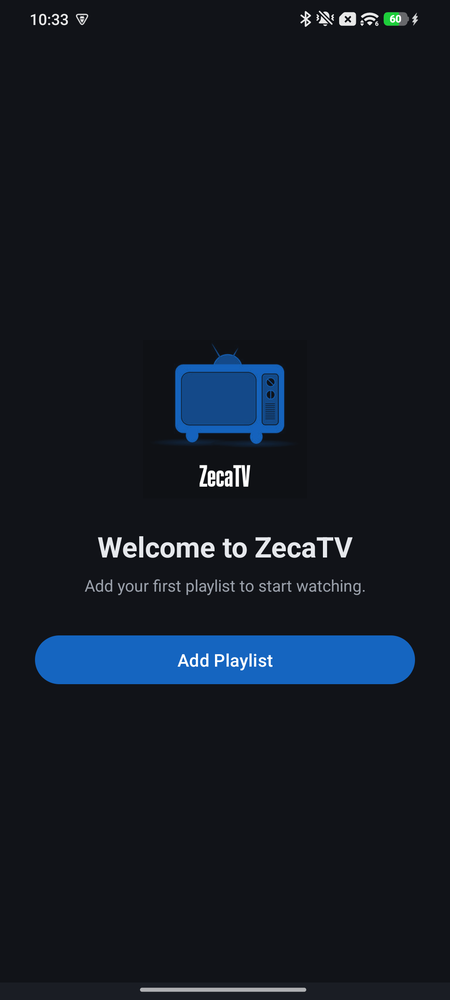
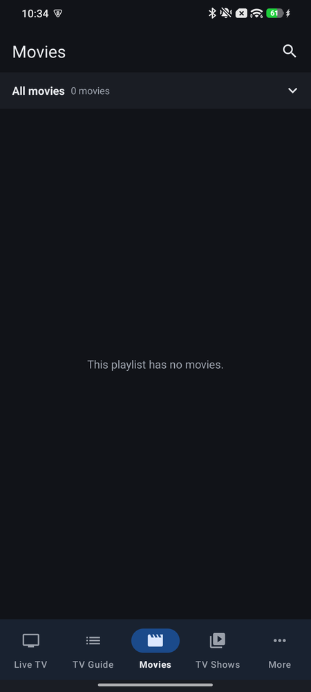
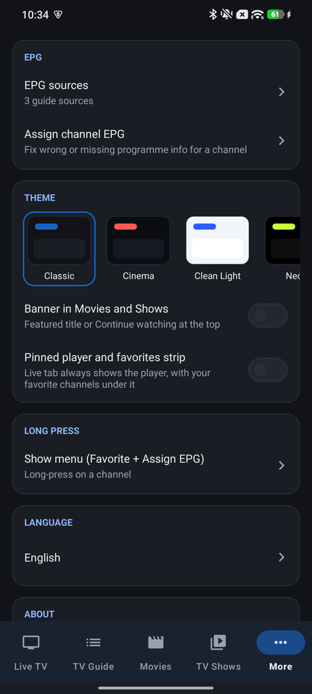
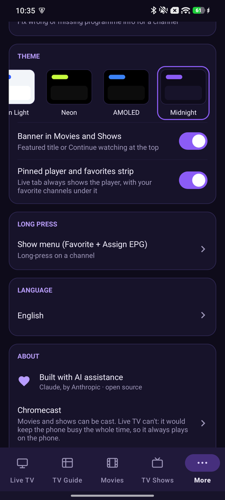

# ZecaTV for Android phones

Native Kotlin IPTV player for Android phones (Android 14 and newer), with a touch-first UI.
It is the phone counterpart of the [ZecaTV Android TV app](https://github.com/andcar89/ZecaTV-AndroidTV)
and shares its playlist, EPG and content-classification code. Media3 / ExoPlayer playback,
Material 3 dark theme.

> **Note:** This app was built with AI assistance (Claude, by Anthropic) — every feature, fix, and line in this repo was written by Claude, prompted and directed by a human. It's a personal project, provided as-is with no warranty; use it at your own discretion.

## Screenshots

<p>
  
  
  
  
</p>

## Features

- **Playlists:** M3U URL, M3U file and Xtream Codes; several saved playlists, switch / edit / delete
- **Live TV:** channel list with now/next progress, favorites, category sheet, inline search, mini-player
- **Fullscreen player:** tap controls, brightness/volume swipes, audio and subtitle picker, channel
  prev/next, side panel with category picker, aspect ratio, picture-in-picture, first-run tutorial
- **TV Guide:** day-by-day timeline, now line, categories, search, programme details
- **Movies and TV Shows:** poster grid, detail page, resume position, seasons / episodes, continue
  watching, next-episode autoplay
- **Chromecast** for movies and shows (Default Media Receiver; needs Google Play services). Live TV is
  deliberately not castable: most providers serve live HLS without the CORS headers the receiver
  requires, and relaying it would keep the phone busy, so live channels always play on the phone
- **MP2 audio** (MPEG-1 Layer II, common on European DVB-style channels) through a built-in software
  decoder, because most phones cannot decode it natively
- **Settings (More tab):** playlists, EPG sources and per-channel guide mapping, themes, long-press
  action, language (System / English / Português), replayable tutorial
- **8 themes:** Classic, Cinema, Clean Light, Neon, AMOLED, Midnight, Forest, Amber, each with its
  own navigation icons; optional layouts (banner in Movies/Shows, pinned player + favorites strip in Live)

## How the UI works

- **Bottom navigation:** Live · Guide · Movies · Shows · More. Favorites is the first category
  inside each section; search is in the top bar.
- **Live TV:** tap a channel to preview it at the top of the list (portrait) — tap the preview
  or the fullscreen button to go fullscreen. In landscape a tap goes straight to fullscreen.
  Long-press a channel for favorites.
- **Fullscreen player:** tap to show/hide controls · swipe up/down on the left half for
  brightness, right half for volume · swipe left from the right edge (or tap *Channels*)
  for the channel panel · double-tap on movies to seek ±10 s.

## Building

Open the project in Android Studio (Hedgehog or newer), let Gradle sync, then run on a device or
emulator running Android 14+. The debug APK is named `ZecaTV-Phone-debug.apk`.

| | |
|---|---|
| `applicationId` | `com.ze.iptvplayer.mobile` (installs alongside the TV app) |
| `minSdk` / `targetSdk` / `compileSdk` | 34 / 34 / 34 |
| Language / UI | Kotlin, ViewBinding, Material 3 |
| Playback | Media3 (ExoPlayer, HLS, OkHttp data source) |
| Other | OkHttp, Gson, Glide, coroutines, JLayer (MP2 audio), Cast SDK |

## Project layout

```
app/src/main/java/com/ze/iptvplayer/
  model/ parser/ data/ network/   shared with the TV app (playlist sources, M3U/Xtream/XMLTV
                                  parsing, EPG, content-type classification, favorites)
  player/PlayerHolder.kt          one ExoPlayer (plus CastPlayer) shared by the mini-player and fullscreen player
  player/Mp2Audio.kt              MP2 audio renderer/decoder (JLayer)
  cast/                           Chromecast options and media item building
  util/ThemeManager.kt            theme switching
  ui/                             Live tab, category sheet, More tab, channel adapter
  MainActivity.kt                 bottom navigation + playlist loading overlay
  PlayerActivity.kt               fullscreen player (live and movies)
  DetailActivity.kt               movie / TV show detail page
  ui/GuideFragment.kt, ui/guide/  TV Guide (custom-drawn timeline views)
  EpgSourcesActivity.kt, ChannelMappingActivity.kt   guide sources and per-channel guide mapping
```

## Notes

- Many IPTV panels use broken TLS certificates, so the app deliberately skips certificate
  validation for playlist, EPG and stream requests (`network/LenientTls.kt`). Only add sources
  you trust.
- Channels are classified as Live / Movies / TV Shows from each entry's own name and URL, never
  from `group-title` (see `parser/ContentTypeClassifier.kt`).
- Categories keep the order of the M3U file.
- This app does not provide any content. You bring your own playlist from a provider you have the
  right to use.
- Live TV cannot be cast (see Features); movies and shows can.

## Third-party software

- AndroidX Media3 (ExoPlayer, HLS, Cast), OkHttp, Gson, Glide, Kotlin coroutines — Apache 2.0 / BSD
- [JLayer](https://github.com/mahozad/jlayer) (javazoom, via `com.googlecode.soundlibs:jlayer`) —
  LGPL, used unmodified as a library for MP2 audio decoding
- Google Cast SDK and Play services — Google's terms

## License

MIT — see [LICENSE](LICENSE).
